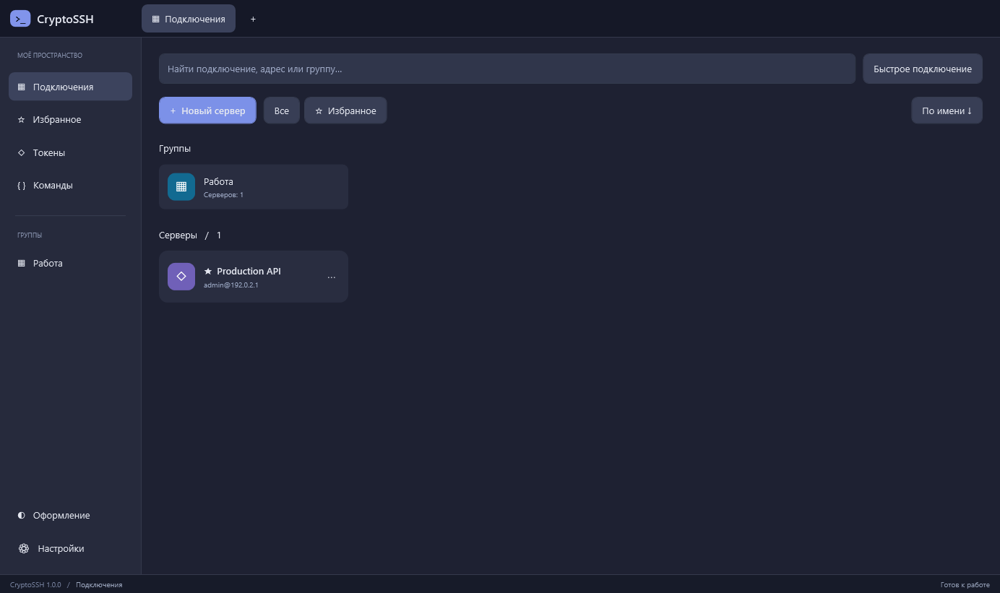
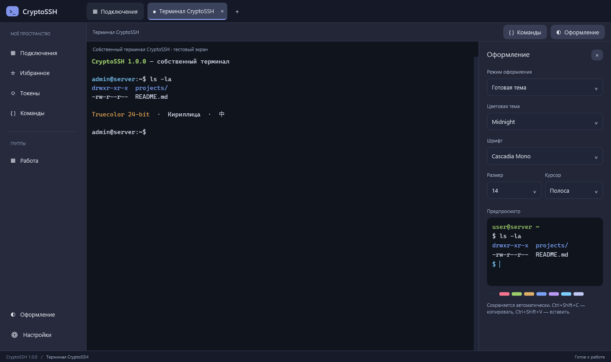

# CryptoSSH

**Нативный SSH-клиент для Windows с аппаратными ключами Рутокен и JaCarta.**

[](https://github.com/asv02-AA/CryptoSSH/releases/latest)
[](https://github.com/asv02-AA/CryptoSSH/actions/workflows/build.yml)
[](LICENSE)

CryptoSSH объединяет сохранённые подключения, вкладки терминала, настройку оформления и работу с RSA-ключами на USB-токенах. Интерфейс и терминал написаны на C# / WPF; SSH работает внутри приложения через SSH.NET. Windows OpenSSH, OpenSC, Electron и отдельное консольное окно для работы не нужны.

[Скачать 1.0.0](https://github.com/asv02-AA/CryptoSSH/releases/tag/v1.0.0) · [Сообщить об ошибке](https://github.com/asv02-AA/CryptoSSH/issues/new/choose) · [История изменений](CHANGELOG.md)





*Снимки тестового профиля; адрес сервера демонстрационный.*

## Возможности

- Подключение по паролю, файлу закрытого SSH-ключа, через Windows SSH-agent или аппаратный RSA-ключ PKCS#11.
- Автоматическое обнаружение подключённых токенов через выбранные библиотеки. При нескольких устройствах — выбор токена, затем ключа по метке, ID и отпечатку.
- Генерация RSA 2048 / 3072 / 4096 непосредственно на токене, если размер поддерживается устройством. Закрытый ключ создаётся чувствительным и неизвлекаемым.
- Экспорт публичной части уже существующего ключа в `.pub` для подключения новых серверов.
- Именованные профили, группы, избранное, поиск и до 12 вкладок подключений.
- Собственный терминал с ANSI/VT, цветами, выделением, прокруткой, копированием и вставкой.
- Темы терминала, отдельный выбор фона и цвета текста, шрифт, размер и вид курсора.
- Сохранённые команды: выбор отправляет команду вместе с Enter и сразу выполняет её.

## Установка и первый запуск

Требуется **Windows 10 2004+ или Windows 11, x64**. Среда .NET включена в дистрибутив; устанавливать SDK для запуска не нужно.

1. Скачайте `CryptoSSH-1.0.0-Setup-x64.exe` из [Releases](https://github.com/asv02-AA/CryptoSSH/releases/latest) и установите клиент. Установщик запрашивает права администратора для установки в Program Files.
2. Или распакуйте **весь** архив `CryptoSSH-1.0.0-win-x64.zip` в отдельную папку и запустите `CryptoSSH.exe`. Не переносите один EXE без остальных файлов.
3. Для входа по паролю или файлу SSH-ключа драйверы токенов не нужны. Создайте профиль в разделе «Подключения».
4. Для аппаратного ключа установите ПО **только своего производителя** и подключите библиотеку по инструкции ниже.

В релиз приложены SHA-256 в `SHA256SUMS.txt`. Проверить файл можно командой `Get-FileHash .\CryptoSSH-1.0.0-Setup-x64.exe -Algorithm SHA256`. Дистрибутив пока не подписан сертификатом издателя; Windows может показывать предупреждение о неизвестном издателе.

## Подключение библиотек токенов

**Библиотеки и драйверы производителей не входят в CryptoSSH.** Приложение не скачивает и не устанавливает их. Поддерживаются три конфигурации: только Рутокен, только JaCarta или обе библиотеки. Ненужное поле в настройках оставьте пустым и сохраните настройки — такая библиотека не загружается и не опрашивается.

### Только Рутокен

1. Установите официальные [драйверы Рутокен для Windows](https://www.rutoken.ru/support/download/windows/) с сайта производителя. Подключите устройство и убедитесь, что Windows его распознаёт.
2. Откройте **Настройки → Компоненты подключения** в CryptoSSH.
3. Нажмите **«Найти установленные библиотеки»**. Приложение ищет `rtpkcs11ecp.dll` в системной папке Windows. На стандартной Windows x64 это `C:\Windows\System32\rtpkcs11ecp.dll`.
4. Если поле осталось пустым, нажмите `…` рядом с **Рутокен · PKCS#11** и укажите установленную **x64** библиотеку. При необходимости используйте официальный [раздел PKCS#11](https://www.rutoken.ru/support/download/pkcs/) и инструкцию производителя.
5. Очистите поле **JaCarta · PKCS#11**, если JaCarta не используется. Нажмите **«Сохранить настройки»**.

### Только JaCarta

1. Установите подходящий для вашей модели [Единый Клиент JaCarta для Windows x64](https://www.aladdin-rd.ru/support/downloads/jacarta_client/) с официального сайта. Подключите устройство.
2. Откройте **Настройки → Компоненты подключения → «Найти установленные библиотеки»**.
3. Для JaCarta нужна **`jcPKCS11-2.dll` (x64)**. Приложение проверяет системную папку, обычно `C:\Windows\System32\jcPKCS11-2.dll`. Размещение зависит от пакета: если библиотека не найдена, выберите установленную DLL кнопкой `…` в поле **JaCarta · PKCS#11**.
4. Очистите поле **Рутокен · PKCS#11**, если он не используется, и сохраните настройки.

Для двух производителей заполните оба поля. На x64 Windows папка `SysWOW64` содержит 32-разрядные библиотеки — они не подходят этому клиенту. Выбирайте только доверенные DLL производителя: библиотека загружается в процесс приложения.

Кнопка поиска повторно определяет обе установленные системные библиотеки. После неё можно снова очистить ненужное поле. Если выбранная DLL больше не существует, удалите её путь или укажите новый перед сохранением.

### Генерация и экспорт ключа

1. Откройте **«Токены»**, выберите устройство по модели и серийному номеру. Для комбинированной JaCarta выберите RSA/PKI-слот: ГОСТ-слот не подходит для RSA SSH.
2. Для нового ключа задайте метку, свободный HEX ID (например `01`) и доступную длину RSA. Нажмите **«Создать SSH-ключ»**, подтвердите устройство и введите PIN. Не извлекайте токен до завершения операции.
3. Для уже существующего ключа генерация не нужна. Нажмите **«Экспорт публичного ключа»**, выберите ключ по метке и отпечатку, сохраните `.pub`.
4. Добавьте **одну полную строку** из `.pub` в `~/.ssh/authorized_keys` нужного пользователя на сервере. Сохраняйте имеющиеся строки других ключей. На Linux обычно нужны права `700` для `~/.ssh` и `600` для `authorized_keys`, владелец — этот пользователь.
5. Создайте профиль: адрес сервера, SSH-порт, имя пользователя и способ входа **«Токен»**. Если подключено несколько RSA-устройств, клиент предложит выбрать нужное; если на нём несколько ключей — выбрать ключ. Затем введите PIN.

Один токен может содержать несколько ключей; список устройств и список ключей — разные списки. Экспорт сохраняет только публичную часть. Сертификат ЭЦП сам по себе не означает наличие совместимого RSA SSH-ключа. ГОСТ-подпись SSH не реализована.

## Данные и доверие серверам

- Профили, команды, оформление и пути библиотек хранятся локально в `%LOCALAPPDATA%\RutokenSSH\connections.json`. Имя папки сохранено для совместимости с ранними версиями. Данные профилей не шифруются; пароли, PIN и парольные фразы в файл не записываются.
- Ключи серверов находятся в `known_hosts` в той же папке и доступны через **Настройки → Ключи серверов**.
- **При первом подключении ключ сервера принимается автоматически.** Это доверие при первом использовании, без независимой проверки подлинности первого подключения.
- При изменении ключа появляется предупреждение с прежним и новым отпечатками. Продолжение возможно после подтверждения и заменяет сохранённый ключ. Сверьте новый отпечаток с администратором по доверенному каналу.
- Удаление приложения не удаляет профили, системные драйверы и ключи на токене. Для резервной копии настроек закройте клиент и скопируйте папку данных.

## Ограничения и диагностика

| Ситуация | Что проверить |
| --- | --- |
| Нет устройств | Драйвер установлен, токен распознаётся Windows, в настройках задана нужная x64 DLL. Ненужную библиотеку можно оставить пустой. |
| Не загружается библиотека | Путь, разрядность DLL, установка её зависимостей официальным пакетом. После обновления драйвера перезапустите клиент. |
| Недоступна длина RSA | Выбранный слот должен поддерживать RSA-генерацию. Не каждый eToken/ГОСТ-слот её поддерживает. |
| На токене несколько ключей с одним ID | Выбирайте по отпечатку. Клиент сопоставляет RSA-параметры и проверяет подпись локально; неразличимые закрытые объекты могут потребовать исправления средствами производителя. |
| Сервер не принимает ключ | Публичная часть добавлена правильному пользователю; разрешена аутентификация по ключу; верны владелец и права `authorized_keys`. |
| Неверный или заблокированный PIN | Не повторяйте попытки наугад. Разблокировка и смена PIN выполняются средствами производителя. |

В 1.0.0 нет SFTP, GUI для туннелей/ProxyJump, импорта PuTTY, инициализации токенов и управления сертификатами. Терминал поддерживает базовые ANSI/VT-сценарии, но не заявляет полную совместимость с xterm. Работа зависит от механизмов конкретной модели токена; полный парк устройств не проходил аппаратную сертификацию. Проект независимый, не официальный клиент «Актив» или «Аладдин Р.Д.».

## Сборка из исходников

На Windows x64 установите [.NET SDK 10](https://dotnet.microsoft.com/download/dotnet/10.0). Для установщика дополнительно нужен [NSIS 3](https://nsis.sourceforge.io/Download) с `makensis.exe` в PATH. Драйверы производителей для сборки **не требуются**.

```powershell
git clone https://github.com/asv02-AA/CryptoSSH.git
cd CryptoSSH
dotnet restore native/CryptoSSH/CryptoSSH.csproj --locked-mode
powershell -File scripts/build-native.ps1 -SkipInstaller
powershell -File scripts/test-native.ps1
# Полная сборка установщика при наличии NSIS:
powershell -File scripts/build-native.ps1
python scripts/verify-installer.py
```

Результат: `release/app-1.0.0/` и `release/CryptoSSH-1.0.0-Setup-x64.exe`. Тесты используют отдельные каталоги `artifacts/`, не меняют пользовательские профили. Интеграционные проверки описаны в [VERIFICATION.md](VERIFICATION.md).

## Аналоги

SSH со смарт-картами и PKCS#11 существовал до CryptoSSH: см. [PuTTY CAC](https://github.com/NoMoreFood/putty-cac), [OpenSSH + PKCS#11](https://github.com/OpenSC/OpenSC/wiki/OpenSSH-and-smart-cards-PKCS%2311) и [руководство JaCarta для SSH](https://www.aladdin-rd.ru/upload/guides/Authentication_using_SSH_JaCarta_PKI.pdf). CryptoSSH не претендует на первенство; задача проекта — удобный нативный интерфейс, собственный терминал и общая работа с Рутокен/JaCarta.

## Лицензия и участие

Собственный код — [MIT](LICENSE). Зависимости сохраняют свои лицензии: [THIRD-PARTY-NOTICES.md](THIRD-PARTY-NOTICES.md). Проприетарные драйверы и PKCS#11-библиотеки не распространяются в репозитории или релизе; пользователь получает их у производителей и принимает их условия самостоятельно.

[Как предложить изменение](CONTRIBUTING.md) · [Политика безопасности](SECURITY.md)
